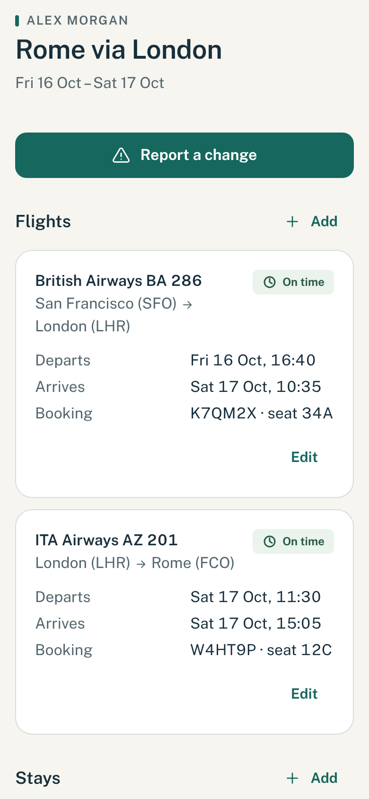
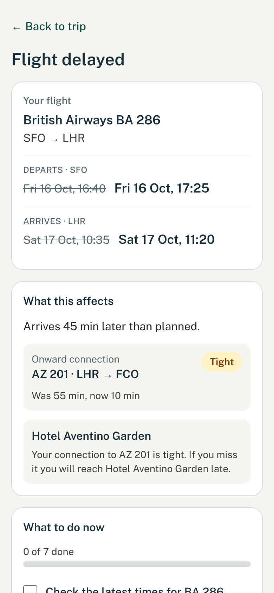

# ConnectionKeeper

Built for the "Into the Skies" hackathon.

When a flight is delayed or cancelled, travelers juggle an airline app, confirmation
emails and a hotel booking, while someone waits for news. ConnectionKeeper keeps the
trip in one place. You tell it what changed. It shows what is now at risk downstream,
gives you a checklist of what to do, and writes an update for the people waiting on you.

The trip drives the checklist, and both drive the update. Everything stays on the
device: there is no backend and no account. A shared update travels inside the link
itself.

## What it looks like

The three screens of the demo, on a phone: the trip, what a 45-minute delay puts at risk, and the update ready to send.

| The trip | What is at risk | The update |
| --- | --- | --- |
|  |  |  |

## Run it

You need Node.js 20 or newer and [pnpm](https://pnpm.io).

```bash
pnpm install
pnpm dev
```

Open http://localhost:3000 and tap **Try the sample trip**. It is designed for a phone, so
use a narrow window or your browser's device mode.

Other commands:

```bash
pnpm test    # unit tests (Vitest)
pnpm lint    # ESLint
pnpm build   # production build
```

## Try the demo

1. Tap **Try the sample trip**: San Francisco to Rome, changing planes in London.
2. Wait about 6 seconds. The airline "changes" the trip on its own and a notification
   card appears: the first flight is over two hours late, so the London connection is
   missed and the traveler is rebooked on AZ 207.
3. See the new plan and the checklist that follows.
4. Tick a task or two, then tap **Share the new plan** to preview the message and copy a link.
5. Open the link. It is a read-only page that needs no app and no account.

To replay it, open the menu (top right) and choose **Restart the demo trip**.

**Live flight watching is simulated.** There is no flight-data feed and no backend: a
scripted change is pushed a few seconds after the trip loads. Everything after the change
(risks, checklist, shared update) is computed from the trip by the app's own logic.

The full walk-through is in [docs/demo-script.md](docs/demo-script.md), and the spoken
pitch is in [docs/pitch.md](docs/pitch.md).

## Screens

| Route | What it is |
| --- | --- |
| `/` | The trip: on-track view, then the change, the checklist, share and listen |
| `/share/[id]` | Build and copy the update for people waiting |
| `/s` | Read-only shared update, with the data in the URL fragment |

## How it is built

Next.js (App Router), TypeScript, Tailwind, Zustand persisted to `localStorage`, Zod,
Vitest and lz-string. The logic is pure functions in `src/lib/domain/`. All times are
local wall-clock strings with no timezone, because every comparison happens at a single
airport or city.

[CLAUDE.md](CLAUDE.md) is the contract for contributors: the data model, the store, the
domain functions and who owns which files.

## Built by

Four people in a 24-hour hackathon.

| Who | What they built |
| --- | --- |
| Namish | Head coder |
| Boris | Code and logic: the connection, checklist and message |
| Will Kim | Frontend design: the screens and the look |
| Sebastian | Presenter: the pitch and the demo |
