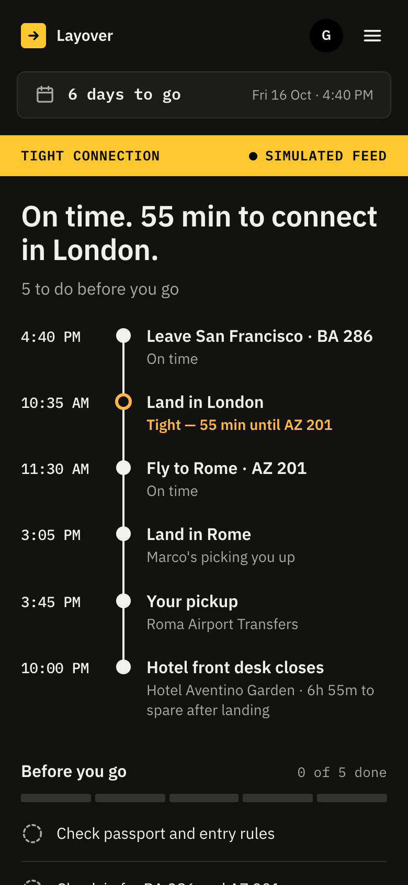
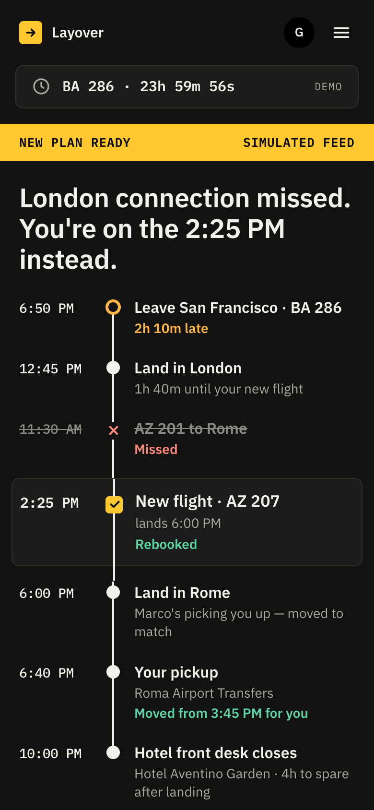
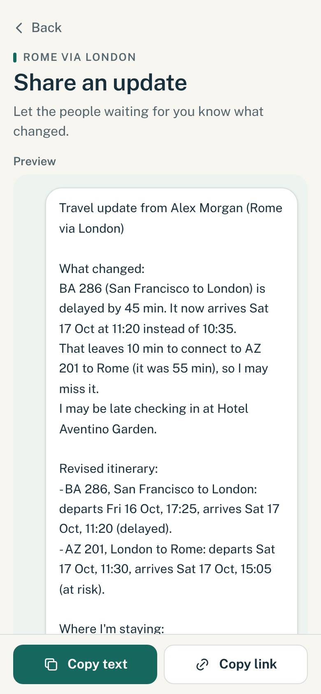
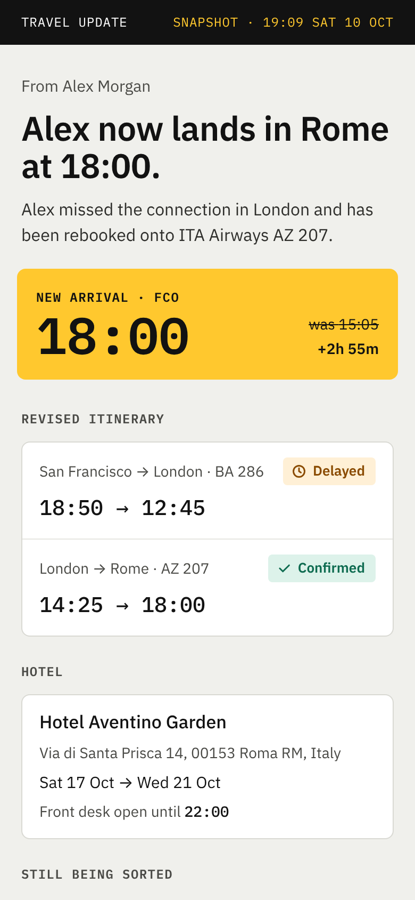

# Layover

Built for the "Into the Skies" hackathon.

When a flight is delayed or cancelled, travelers juggle an airline app, confirmation
emails and a hotel booking, while someone waits for news. Layover keeps the
trip in one place. When a flight changes (in this demo, from a simulated airline feed), it
shows what is now at risk downstream, gives you a checklist of what to do, and writes an
update for the people waiting on you.

The trip drives the checklist, and both drive the update. Trips stay on the device: there
is no database, and sign-in is a demo profile kept on the phone (or continue as a guest). A
shared update travels inside the link itself. Two optional extras use a server route:
importing bookings from pasted text (Anthropic) and the spoken summary (ElevenLabs).

## What it looks like

The demo on a phone: the trip is on track, the airline changes a flight, the plan rebuilds
itself, and the update is ready to send to the person waiting.

| On track | New plan | Share it | What they see |
| --- | --- | --- | --- |
|  |  |  |  |

## Try it

Live: **https://connectionkeeper.vercel.app** (open it on a phone, tap **Continue as guest**,
then **Try the sample trip**).

## Run it

You need Node.js 20 or newer and [pnpm](https://pnpm.io).

```bash
pnpm install
pnpm dev
```

Optional: copy `.env.example` to `.env.local` and add `ANTHROPIC_API_KEY` (import from
text) and `ELEVENLABS_API_KEY` (Listen to summary). Without them, import says it is not
available and Listen uses the phone's built-in voice; everything else works.

Open http://localhost:3000, tap **Continue as guest**, then **Try the sample trip** (or
**Add your trip** to enter your own). It is designed for a phone, so
use a narrow window or your browser's device mode.

Other commands:

```bash
pnpm test    # unit tests (Vitest)
pnpm lint    # ESLint
pnpm build   # production build
```

## Try the demo

1. Tap **Try the sample trip**: San Francisco to Rome, changing planes in London.
2. Tap **Next: Change the flight** (bottom right) or **Simulate a change**. (With Demo
   controls switched off in Settings, it also happens by itself after about 6 seconds.) The airline "changes" the trip and
   a notification card appears: the first flight is over two hours late, so the London
   connection is missed and the traveler is rebooked on AZ 207.
3. See the new arrival on the board, the trip as a rail that shows what is affected,
   **Handled for you** (the hotel told and the airport pickup moved, both simulated), and
   one **Do this now** task.
4. Tap **Share the new plan**, then **WhatsApp**, **Text** or **Email** on a person's
   message. The app opens with the text filled in (nothing is sent from here).
5. Open a shared link. It is a read-only page that needs no app and no account.

To replay it, open the menu (top right) and choose **Restart the demo trip** (then confirm),
or **Pick a scenario** (delay, 3-hour delay, missed connection, cancellation).

**Live flight watching is simulated.** There is no flight-data feed: a scripted change is
pushed a few seconds after the trip loads. "Handled for you" is simulated too: no message
reaches a hotel or driver. Everything after the change (risks, checklist, shared update) is
computed from the trip by the app's own logic.

The full walk-through is in [docs/demo-script.md](docs/demo-script.md), and the spoken
pitch is in [docs/pitch.md](docs/pitch.md).

## Screens

| Route | What it is |
| --- | --- |
| `/` | The trip: on-track view, then the change, the checklist, share and listen; saved trips when no trip is open |
| `/trip` | Add or edit flights, hotels and rides, or import them from pasted text |
| `/login` | Demo sign-in kept on the phone, or continue as a guest |
| `/settings` | Profile, what Layover may do by itself, alerts, theme |
| `/share/[id]` | Per-person messages to send, and the update to copy |
| `/s` | Read-only shared update, with the data in the URL fragment |

## How it is built

Next.js (App Router), TypeScript, Tailwind, Zustand persisted to `localStorage`, Zod,
Vitest and lz-string. The logic is pure functions in `src/lib/domain/`. All times are
local wall-clock strings with no timezone, because every comparison happens at a single
airport or city.

[CLAUDE.md](CLAUDE.md) is the contract for contributors: the data model, the store, the
domain functions and who owns which files.

## Built by

Four people in a 24-hour hackathon.

| Who | What they built |
| --- | --- |
| Namish | Head coder |
| Boris | Code and logic: the connection, checklist and message |
| Will Kim | Frontend design: the screens and the look |
| Sebastian | Presenter: the pitch and the demo, and the Solana "Send help" button |
