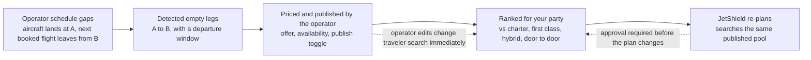

# JetFlex: why this works (one slide)

A single-screen layout spec. Paste the "Slide copy" section straight into a slide; the
diagram is given both as ASCII (paste anywhere) and as Mermaid (for tools that render it).
Everything inventory-related in the demo is simulated; the footer says so on the slide.

## Layout

Landscape 16:9. Title across the top. Diagram band directly under the title, full width.
Below it, four equal blocks in one row (numbered 1 to 4, matching the diagram nodes).
One footer line at the bottom. Nothing else on the slide.

```
+--------------------------------------------------------------------------------+
| TITLE                                                                          |
| subtitle                                                                       |
+--------------------------------------------------------------------------------+
|  [diagram: schedule gaps -> empty legs -> price + publish -> rank -> re-plan]  |
+----------------+----------------+-----------------+----------------------------+
| 1 DETECT       | 2 PRICE +      | 3 RANK          | 4 RE-PLAN                  |
|                |   PUBLISH      |                 |                            |
| 3 lines        | 3 lines        | 3 lines         | 3 lines                    |
+----------------+----------------+-----------------+----------------------------+
| footer: what is real, what is simulated                                        |
+--------------------------------------------------------------------------------+
```

## Slide copy

**Title:** Idle aircraft become options. Options become recovery.

**Subtitle:** One inventory, built from the operator's own schedule, serves both the
planner and the safety net.

### Diagram (ASCII)

```
 operator          detected          priced +           ranked for          JetShield
 schedule   --->   empty legs  --->  published   --->   your party   --->   re-plans
 gaps                                by operator        vs charter /        on disruption
                                                        first class /       from the
 JX101 lands TEB,  TEB -> OPF        $4,850 offer       hybrid              same pool
 next booked       window, 6 seats   (charter est.
 flight is OPF     25h 53m idle      $13,100)
```

### Diagram (Mermaid)



### Four blocks

**1. Detect.** Take each aircraft's booked flights in time order. Where one lands at an
airport other than the one the next flight leaves from, that gap is a repositioning flight
nobody is on. JetFlex computes the window it can fly in (after a 60 minute turnaround,
early enough to make the next booking), skips legs the aircraft cannot fly nonstop, and
drops gaps longer than 72 hours. The schedule can be seeded, typed in, or imported from an
operator CSV; the detector does not care.
*Example in the demo: JX101 lands at TEB, its next booked flight leaves OPF, so TEB to OPF
is detected, 25h 53m idle.*

**2. Price and publish.** The operator, not the traveler, decides what is offered. JetFlex
suggests an offer from the charter estimate and how wide the timing window is; the
operator can set a price, mark it limited or unavailable, or leave it unpublished.
*Example: TEB to OPF, Phenom 300E, charter estimate $13,100, suggested offer $4,850.*

**3. Rank.** For the same party and dates, JetFlex builds charter, empty leg, first class
and hybrid journeys door to door, scores them on cost, time, ground time, connections,
schedule fit, certainty, privacy and control, and writes the explanation from the same
numbers that produced the ranking.
*Example: the same trip is about $10,110 on empty legs against $26,610 by charter.*

**4. Re-plan.** When a flight breaks, JetShield finds where you are, searches the same
published pool for replacements that fit your party, timing and return journey, ranks
them with your priorities, and changes nothing until you approve.
*Example: aircraft pulled from service, so the traveler is offered the TEB to OPF
empty leg that block 1 detected.*

### Footer

Simulated: schedules, fares, tail numbers, availability, demand and disruptions. Real:
airport coordinates, great-circle distances, and the detection, pricing, ranking and
recovery logic. Not bookable.

## Speaker notes (30 seconds)

"The mechanism is one chain. An operator's schedule has gaps where the aircraft has to
reposition. We detect those gaps, the operator prices and publishes them, we rank them
against charter and first class for the traveler's exact party, and when something breaks
we re-plan from that same pool. The inventory in this demo is simulated. The chain is the
product."

## Design notes for whoever builds the slide

- Use the diagram as the visual anchor; do not add a second chart.
- Keep block text to the bold lead sentence plus the italic example. The longer paragraph
  above is for the speaker, not the slide.
- Colors: the app uses a dark navy with a gold accent; match it if you want the slide to
  look like the product.
- If the slide has room for one more line, add: "Operator controls: price, availability,
  publish. Traveler controls: party, dates, flexibility, priorities, approval."
